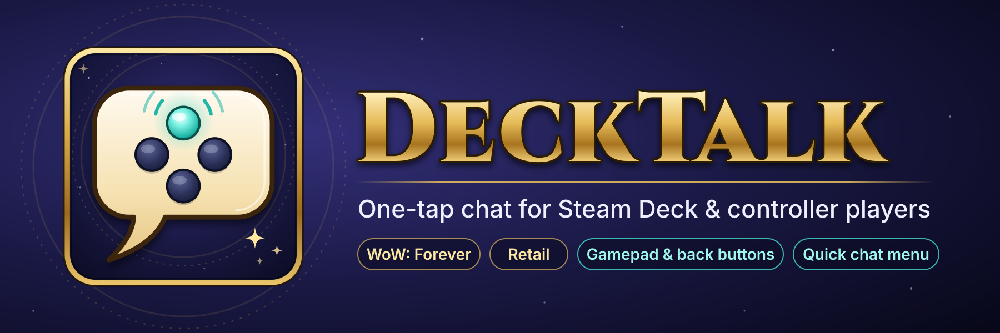

# DeckTalk

One-tap chat for **World of Warcraft: Forever** on **Steam Deck** and controllers. It also works on retail.

Typing on a Steam Deck is slow. DeckTalk gives you a **Quick chat menu** you drive with the D-pad,
plus a small panel and keybinds for the things you say all the time.

## Features
- **Quick chat menu.** One bind opens it:
  - D-pad (or arrow keys) chooses, **A** (or Enter) sends, **B** (or Esc) closes.
  - Left/Right changes where the message goes.
  - The bottom line shows exactly what will be sent.
  - No cursor needed, so it works in WoW: Forever's native Gamepad mode, with ConsolePort, or with Steam Input keyboard mappings.
- **8 quick phrases**: "Hi!", "Thanks!", "Yes", "No", "Inv please?"… all editable.
- **Pick where messages go**:
  - `Auto`: group chat when grouped, otherwise /say
  - `Say` or `Group`
  - `Whisper`: the last person who whispered you

  The title bar always shows the current destination.
- **LFG: quest** posts your tracked quest with your role, level and class in LookingForGroup
  (or General): `LFG [The Defias Brotherhood] - Healer, lvl 18 Druid`.
  The role comes from your spec, or you can set it yourself. With no tracked quest it posts your zone instead.
- **Steam Deck note**: "I'm playing on a Steam Deck and typing is slow…"
  - optionally posted in group chat when you join a group (not in NPC-only groups, never mid-combat)
  - optionally whispered back to people who whisper you, once per player per 10 minutes,
    skipping friends and guild members
- **Made for back buttons.** Every action can be keybound, and the panel shows each button's key.
- **Double-tap safe.** A short cooldown stops accidental double sends and channel spam.
- **Minimize instead of close**, so you're never stuck typing `/dt` to get it back.

## Controller setup

DeckTalk never reads your controller directly. It uses WoW's keybindings, so it works with
whatever controller setup you already have.

### WoW: Forever with the built-in Gamepad mode
1. Turn on **Options → Gamepad (Alpha)**.
2. Open **Keybindings → AddOns → DeckTalk** and bind **Quick chat menu** to a button or button combo.
3. In game: press it, then use the D-pad to choose, **A** to send and **B** to close.

### Steam Deck back buttons (Forever and retail)
Steam Input can turn the back grip buttons into keyboard keys, which works in both games,
with or without ConsolePort:
1. Steam → **Controller settings** → map **L4** to `F7` and **R4** to `F8`.
2. In WoW keybindings: **Quick chat menu** = `F7`, **Quick chat: send selected** = `F8`.
3. Press L4 to open the menu (press it again to go to the next entry) and R4 to send.
   That's every message on two buttons. L5/R5 are free for LFG or your note.

### Retail
Retail only has a basic built-in gamepad mode. Use the back-button setup above, or
[ConsolePort](https://www.curseforge.com/wow/addons/console-port). DeckTalk's panels work with the ConsolePort cursor.

## Placeholders
Use these in any phrase, the note or the LFG message:

| Code | Becomes |
|---|---|
| `%q` | tracked quest (as a clickable link) |
| `%t` | your target's name |
| `%z` | current zone |
| `%w` | role + level + class, e.g. `Healer, lvl 18 Druid` |
| `%r` / `%l` / `%c` | role / level / class on their own |

## Commands
| Command | Does |
|---|---|
| `/dt` | Show / minimize the panel |
| `/dt config` | Edit phrases and options (Steam keyboard: `Steam + X`) |
| `/dt hide` / `/dt show` | Hide completely / show again |
| `/dt scale 1.2` | Resize the panel (0.5–2) |
| `/dt reset` | Move the panel back to its default position |

## Install
Download the latest zip from **Releases** (or CurseForge) and unpack it into
`World of Warcraft/<game version>/Interface/AddOns/`. Your game version folder is the WoW: Forever folder or `_retail_`.

> If you use GitHub's green **Code → Download ZIP** button instead, rename the folder from
> `DeckTalk-main` to `DeckTalk`, or WoW won't load it.

## Notes
- Blizzard only lets addons post in /say and channels (like LFG) when you actually press a button
  or key. That's why the automatic note only goes to group chat and whispers.
- The Quick chat menu borrows the D-pad / arrow keys / Enter / Esc **only while it's open**. It hands
  them back when it closes, after 12 seconds of no input, and right before combat starts.
  In combat, tap a row or use the two Quick chat binds.
- In dungeons and raids during combat, Blizzard restricts addon chat. DeckTalk waits or skips
  instead of throwing errors.

## License
MIT
