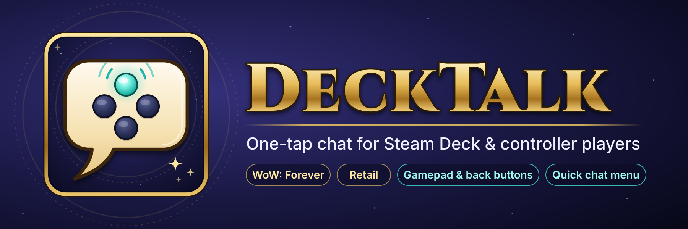

# CurseForge project page – DeckTalk

Everything you need for the CurseForge authors portal, ready to paste.

---

## Project fields

| Field | Value |
|---|---|
| **Name** | DeckTalk |
| **Summary** | Chat without typing: a D-pad Quick chat menu, one-tap LFG for your tracked quest with role & level, and an auto "I'm on a Steam Deck" note. |
| **Primary category** | Chat & Communication |
| **Additional category** | Quests & Leveling |
| **Game versions** | WoW: Forever (main focus), Retail |
| **License** | MIT |
| **Source** | https://github.com/p0jst/DeckTalk |
| **Issues** | https://github.com/p0jst/DeckTalk/issues |
| **Logo** | `media/brand/logo-1024.png` (CurseForge crops and resizes to 400×400) |

**Shorter summary**, if you want it to fit on one line in search results:
> A D-pad Quick chat menu, one-tap LFG, and an auto "I'm on a Steam Deck" note.

---

## Description (paste into the description editor in Markdown mode)

**Typing on a Steam Deck is slow, and the on-screen keyboard always seems to pop up mid-pull.**
DeckTalk puts the things you say all the time one button press away. Open the **Quick chat menu**, pick with the D-pad and press A, and "Thanks!", an LFG post or "inv please?" is sent. It's made for WoW: Forever's new Gamepad mode and the Steam Deck, and works on retail too.

## Features

- **Quick chat menu.** One bind opens it:
  - **D-pad** chooses, **A** sends, **B** closes.
  - **Left/Right** changes where the message goes.
  - The bottom line shows exactly what will be sent.
  - No cursor needed, so it works with WoW: Forever's native Gamepad mode, ConsolePort or Steam Input keyboard mappings. Arrow keys, Enter and Esc work too.
- **8 quick phrases**: *Hi!, Thanks!, Yes, No, One sec, Sorry!, Inv please?, Group up?* All of them are editable.
- **Choose where messages go**:
  - **Auto**: group chat when you're grouped, /say when you're solo
  - **Say** or **Group**
  - **Whisper**: replies to whoever whispered you last

  The title bar always shows the current destination, so you never post in the wrong place.
- **One-tap LFG** posts your tracked quest as a clickable link, with your role, level and class:
  `LFG [The Defias Brotherhood] - Healer, lvl 18 Druid`
  The role comes from your current spec, or you can set Tank / Healer / DPS yourself. With no quest tracked, it posts your zone instead.
- **Your Steam Deck note**: *"I'm playing on a Steam Deck and typing is slow - sorry if I don't reply much!"*
  - Optionally posted in group chat when you join a group. It skips NPC-only groups and waits until combat ends.
  - Optionally whispered back to people who whisper you. It skips friends, guild members and GMs, and replies at most once per player every 10 minutes.
- **Built for back buttons.** Everything can be keybound, and every button shows its key, so the panel doubles as a cheat sheet.
- **Double-tap safe.** A short cooldown prevents accidental double posts and channel spam. Buttons flash **Sent!** when a message goes out.
- **You can't lose it.** The panel minimizes to a small bar instead of closing. Where the addon compartment is available (the minimap addon menu), left-click shows the panel and right-click opens settings.
- **ConsolePort-friendly**: works with the ConsolePort cursor.
- **Lightweight**: no libraries, no dependencies, no data collection.

## Controller setup

DeckTalk uses WoW's own keybindings, so it works with whatever controller setup you already have.

**WoW: Forever, built-in Gamepad mode**
1. Turn on **Options → Gamepad (Alpha)**.
2. Open **Keybindings → AddOns → DeckTalk** and bind **Quick chat menu** to a button or button combo.
3. Press it, then use the D-pad to choose, **A** to send and **B** to close.

**Steam Deck back buttons (Forever and retail)**
1. In Steam → **Controller settings**, map **L4** to `F7` and **R4** to `F8`.
2. In WoW keybindings, set **Quick chat menu** = `F7` and **Quick chat: send selected** = `F8`.
3. Press L4 to open the menu (press it again for the next entry) and R4 to send. That's every message on two buttons. L5/R5 are free for LFG or your note.

**Retail:** Retail only has a basic built-in gamepad mode. Use the back-button setup above, or ConsolePort. DeckTalk works with the ConsolePort cursor.

**Tip:** To write your own phrases, click **Edit** on the panel (or type `/dt config`) and press **Steam + X** to bring up the keyboard. You only have to do this once.

## Placeholders

Use these in any phrase, your note or the LFG message. The settings window shows a live preview of your LFG post.

| Code | Becomes |
|---|---|
| `%q` | your tracked quest (as a clickable link) |
| `%t` | your target's name |
| `%z` | your current zone |
| `%w` | role + level + class, e.g. *Healer, lvl 18 Druid* |
| `%r` / `%l` / `%c` | role / level / class on their own |

## Commands

| Command | What it does |
|---|---|
| `/dt` | Show / minimize the panel |
| `/dt config` | Edit phrases and options |
| `/dt hide` / `/dt show` | Hide completely / show again |
| `/dt scale 1.2` | Resize the panel (0.5–2) |
| `/dt reset` | Move the panel back to its default position |

## FAQ

**Does it work in WoW: Forever and retail?**
Yes. One download supports both.

**Why isn't the automatic note posted in /say or the LFG channel?**
Blizzard only lets addons post in /say and public channels when you actually press a button or key. Automatic messages therefore go only to group chat and whispers. Buttons and keybinds work everywhere.

**Does it work in dungeons and raids?**
Yes. Blizzard restricts addon chat during combat inside instances. DeckTalk waits or skips in that case instead of throwing errors.

**My spec doesn't match the role I want to advertise.**
Open settings and click the **Role** button to set Tank, Healer or DPS yourself. *Auto* goes back to using your spec.

**Do I need ConsolePort?**
No. In WoW: Forever, the built-in Gamepad mode is enough. On retail, Steam Deck back buttons mapped to keys work without it. ConsolePort is supported if you already use it.

**Does the Quick chat menu block my D-pad?**
Only while it's open. It hands the D-pad, arrows, Enter and Esc back when it closes, after 12 seconds of no input, and right before combat starts.

**Do I need a Steam Deck?**
No. DeckTalk works just as well with any controller setup, couch play or one-handed play.

## Feedback

Found a bug or have an idea? Open an issue on [GitHub](https://github.com/p0jst/DeckTalk/issues). The source code is MIT licensed.

---

*DeckTalk is a fan-made addon. It is not affiliated with or endorsed by Blizzard Entertainment or Valve. Steam and Steam Deck are trademarks of Valve Corporation.*

---

## Screenshots to take in-game (upload under Images)

CurseForge wants real in-game screenshots. These six show the addon best:

1. **The Quick chat menu** open in the world, with a phrase selected.
2. **The panel**, expanded, with a couple of keybinds set so the key labels show.
3. **An LFG post in chat** with the clickable quest link, e.g. in a starting zone.
4. **The settings window**, ideally with the LFG preview line visible.
5. **The minimized bar** in a corner of a normal game screen, to show how small it gets.
6. **Steam's controller settings**, with the back buttons mapped to F-keys.
